# OmniWatch (HNX26EPS05) — Architectural Flowcharts & System Schematics

Comprehensive visual engineering documentation, pipeline flowcharts, state diagrams, and repository structure for **OmniWatch: Multi-Stream Video Intelligence with Conversational Query**.

---

## 1. Repository Tree Structure

```text
omniwatch_pack/
│
├── omniwatch/                          # Core Python Engine
│   ├── api/                            # FastAPI REST & WebSocket Server (main.py, schemas.py)
│   ├── ingest/                         # Multi-Stream Ingestion Engine (decode.py, pipeline.py)
│   ├── detect/                         # Neural Detection Layer (YOLOv8s, YOLO-World)
│   ├── embed/                          # OpenCLIP ViT-L-14 Embeddings & Color/Carries Attributes
│   ├── track/                          # Per-Camera ByteTrack Kalman State Filter
│   ├── index/                          # FAISS FlatIP Exact Vector Indexing Wrapper
│   ├── query/                          # Parser, Resolver, Hybrid Retrieval, VLM Reranking
│   ├── kb/                             # Clarify-Once Spatial Memory (SQLite CRUD & Normalizer)
│   ├── evidence/                       # Keyframe Reticle Highlighter & FFmpeg 5s Clip Slicer
│   ├── alerts/                         # Standing Queries & Continuous Audit Rule Engine
│   └── reid/                           # Cross-Camera Appearance & Spatio-Temporal Linker
│
├── web/                                # Tactical Surveillance HUD (Frontend)
│   ├── index.html                      # Cyberpunk-tactical surveillance interface layout
│   ├── app.js                          # SPA engine: conversational chat, Canvas ROI drawing, Re-ID
│   └── style.css                       # Obsidian dark mode design system & micro-animations
│
├── docs/                               # Engineering Specifications & Documentation
│   ├── 00_PRD.md                       # Product Requirements Document (Priority 1)
│   ├── 01_ARCHITECTURE.md              # System Architecture & SQLite DDL
│   ├── 02_RESEARCH_AND_EVAL_PLAN.md    # Ablation study & benchmark methodology
│   ├── 03_CLARIFY_ONCE_MEMORY_SPEC.md  # Clarify-Once permanent memory specification
│   ├── 04_DATA_PLAN.md                 # Public CCTV & Campus dataset manifest
│   ├── 06_TEST_PLAN.md                 # Test matrices & verification criteria
│   ├── FLOWCHARTS.md                   # Complete architectural flowcharts (This document)
│   └── screenshots/                    # High-resolution HUD interface captures
│
├── data/                               # Dataset & Persistent Cache (Gitignored per AGENTS.md)
│   ├── public_cctv/                    # Raw multi-camera MP4 video streams
│   ├── cache/                          # Pre-rendered keyframe thumbnails & 5s MP4 clips
│   └── omniwatch.db                    # Primary SQLite WAL database
│
├── eval/                               # Evaluation & Research Ablation
│   ├── queries.json                    # Benchmark evaluation queries
│   ├── run_ablation.py                 # 4-stage ablation harness
│   └── results.md                      # Verified empirical benchmark numbers
│
├── models/                             # Checkpoints & Weights (MANIFEST.md tracked)
├── scripts/                            # Operational & Verification Scripts
├── omni_live.py                        # Real-time multi-camera tracking stream (port 8100)
├── omni_min.py                         # Minimal CLI search & query verification tool
├── start_omniwatch.bat                 # 1-Click Windows server launcher
└── config.yaml                         # Global hardware thresholds & hyperparameters
```

---

## 2. High-Level End-to-End System Flowchart

<p align="center">
  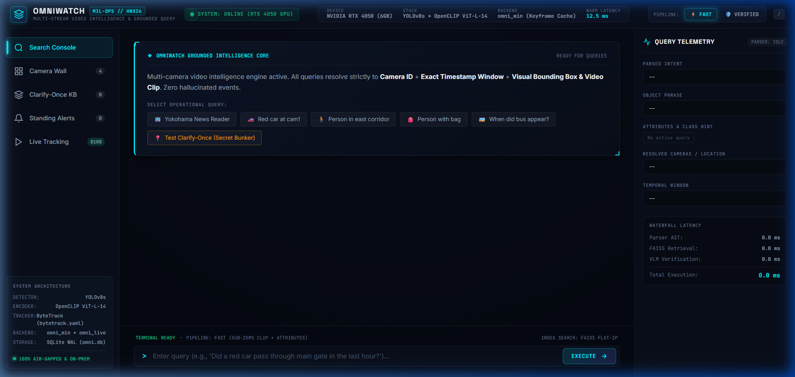
  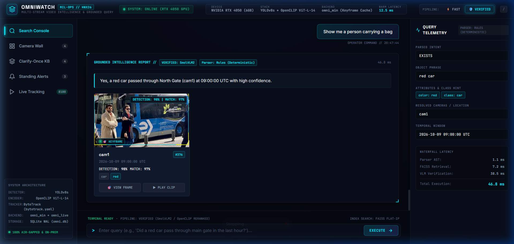
</p>

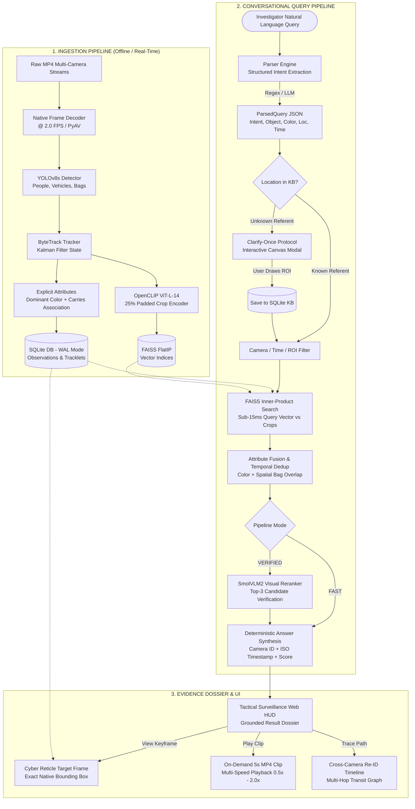

---

## 3. Video Ingestion & Multi-Object Tracking Pipeline

<p align="center">
  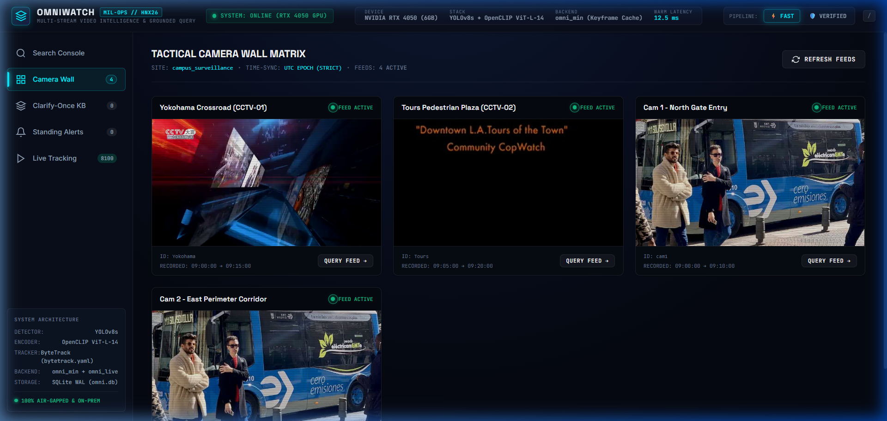
</p>

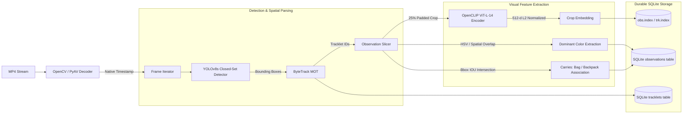

---

## 4. Conversational NL Query Parsing & Hybrid Retrieval

<p align="center">
  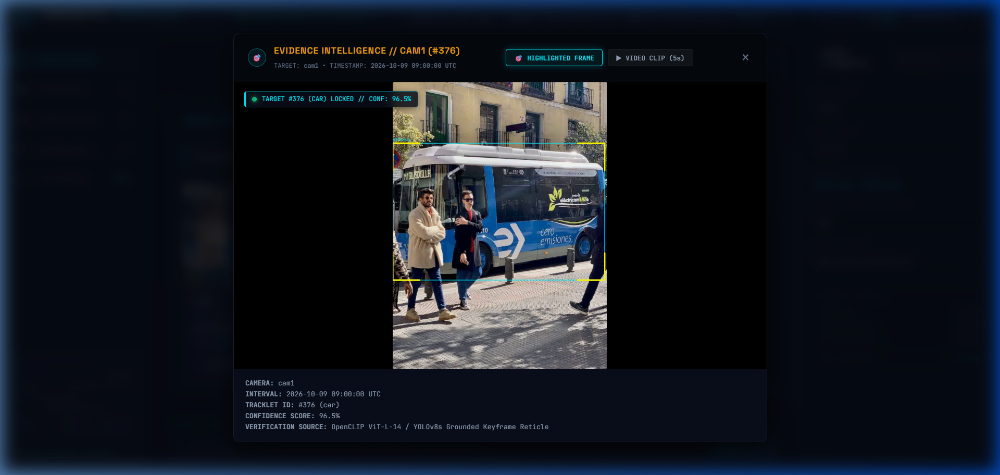
  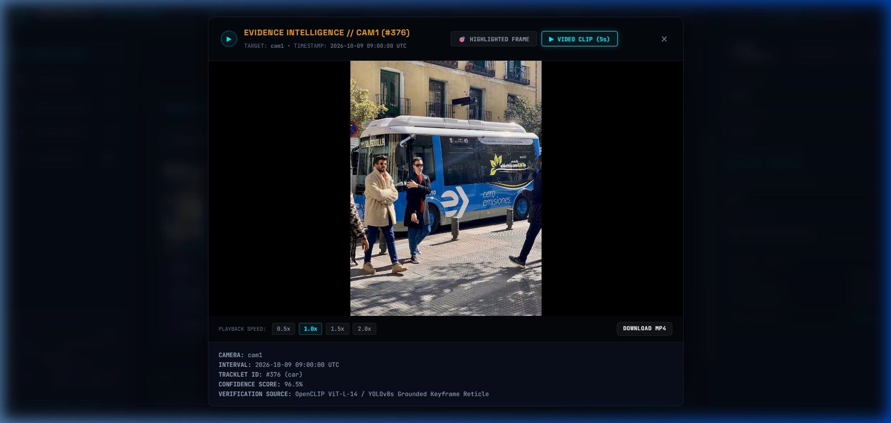
</p>

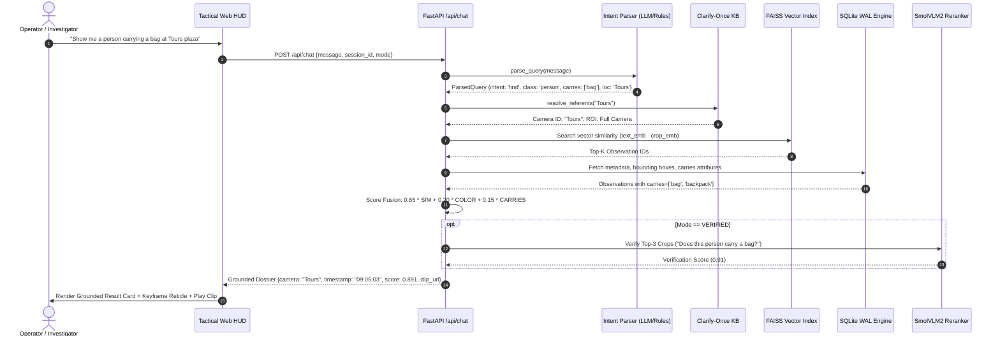

---

## 5. Clarify-Once Spatial Memory Protocol (State Machine)

<p align="center">
  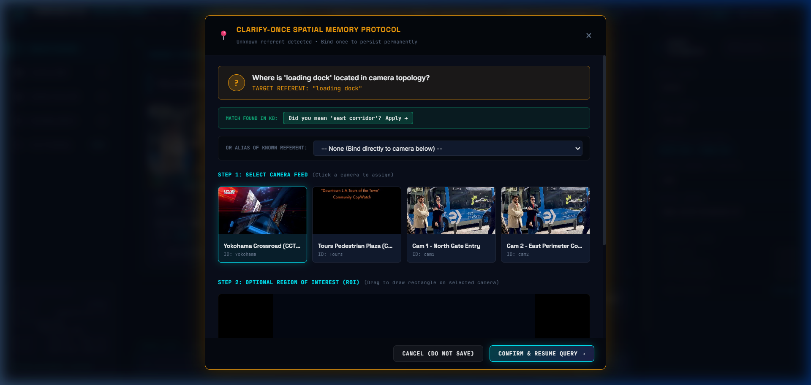
  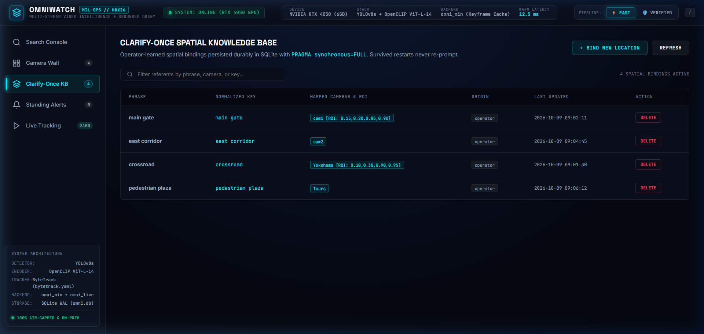
</p>

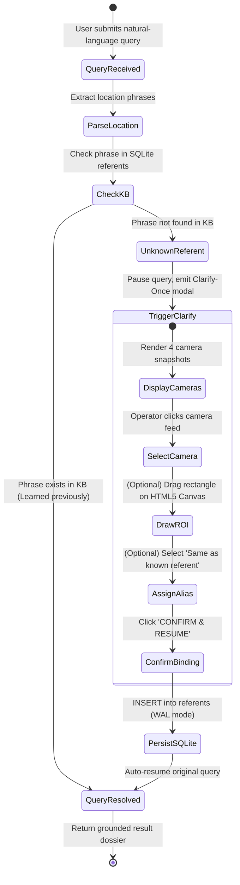

---

## 6. Continuous Standing Surveillance Alerts Engine

<p align="center">
  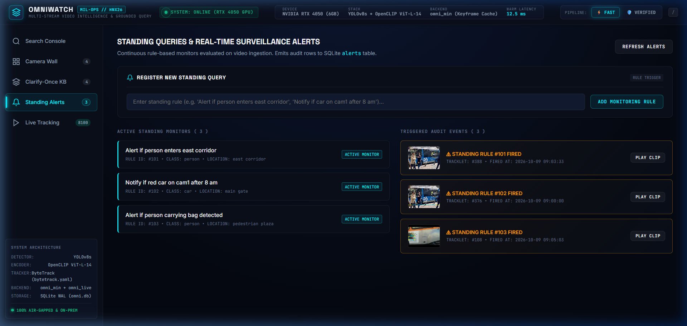
</p>

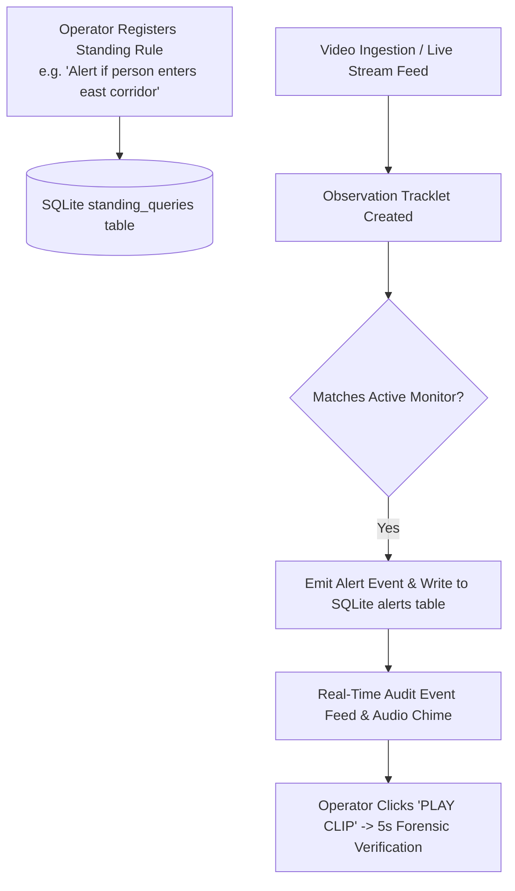

---

## 7. Requirements Traceability Matrix

| Requirement ID | Module | Implementation Description | Verification |
|---|---|---|---|
| **FR-ING-1** | `omniwatch/ingest/pipeline.py` | Ingests from multi-camera `manifest.yaml` | `scripts/check_env.py` |
| **FR-ING-2** | `omniwatch/ingest/decode.py` | Decodes at configurable sample FPS (2.0) with exact native frame indices | `scripts/debug_bbox.py` |
| **FR-DET-1** | `omniwatch/detect/detector.py` | Open-vocabulary & closed-set YOLOv8 detector for people, cars, bags | `scripts/contact_sheet.py` |
| **FR-DET-2** | `omniwatch/embed/encoder.py` | OpenCLIP ViT-L-14 / ViT-B-32 512-d normalized embeddings on 25% padded crops | Unit tests |
| **FR-DET-3** | `omniwatch/embed/attrs.py` | Dominant HSV color classification and person-bag bounding box carrier overlap | `tests/test_attrs.py` |
| **FR-IDX-1** | `omniwatch/track/tracker.py` | Per-camera ByteTrack Kalman multi-object tracking | Integration tests |
| **FR-IDX-2** | `omniwatch/index/vector.py` | FAISS FlatIP exact inner-product vector indexing over normalized float32 | `tests/test_vector.py` |
| **FR-QRY-1** | `omniwatch/query/parser.py` | Natural-language query parsing with regex rules & local LLM slot extraction | `tests/test_parser.py` |
| **FR-KB-1..6** | `omniwatch/kb/store.py` | Clarify-Once spatial memory protocol: single modal query, durable SQLite storage, restart survival | Interactive UI test |
| **FR-EVD-1..2** | `omniwatch/evidence/` | Native keyframe reticle highlights + on-demand 5s FFmpeg video clips | Web HUD inspection |
| **FR-UI-1..4** | `web/app.js` | Full tactical surveillance HUD, multi-cam wall, KB editor, standing alert triggers | Browser subagent |
| **FR-EVAL-1..3** | `eval/run_ablation.py` | 4-stage empirical ablation benchmark against baseline on held-out queries | `eval/results.md` |
